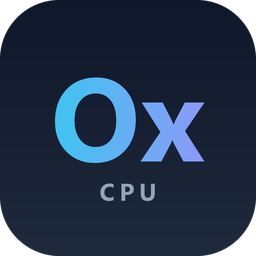

<p align="center">
  
</p>

<h1 align="center">OnnxSharp</h1>

<p align="center">
  <a href="https://www.nuget.org/packages/Sevencat.OnnxSharp"></a>
  <a href="https://www.nuget.org/packages/Sevencat.OnnxSharp"></a>
  
  
  
  
</p>

<p align="center">
  纯 C# 实现的 ONNX 推理引擎 —— <b>只有 CPU</b>（FP32，零第三方依赖），<b>没有</b> CUDA / Vulkan / OpenCL / DirectML 后端。<br>
  可直接跑 YOLO11 / YOLOv8 / RF-DETR / PP-OCRv6 的 ONNX 导出，并附带「一张图进、检测框出 / 文本行出」的可选门面。
</p>

<p align="center">
  <b>中文</b> ｜ <a href="#english">English</a>
</p>

---

## 中文

### 这是什么

`OnnxSharp` 是一个自己实现的 ONNX 运行时：读 ONNX 文件 → 建图 → 常量折叠 + 算子融合 → 缓冲池 + 多线程 SIMD 内核 → 按节点执行。语义对齐 OpenCV 5 `dnn` 与 SimdYolo 的做法，目标是「纯托管、无 P/Invoke、纯 CPU 也能跑检测模型」。

实测与本机 OpenCV 5 dnn 相差 1.15~1.30×（见 [性能](#性能)）。

这个引擎能写出来，主要是站在 **SimdYolo** 和 **OpenCV 5 `dnn`** 的肩膀上：算子语义、预处理约定、性能基线和验证方法都大量借鉴了它们。感谢两个项目的作者与贡献者，具体借鉴点见 [致谢](#致谢)。

### 只做 CPU，不做 GPU

| | |
|---|---|
| **支持** | CPU，FP32，AVX2 / AVX-512 向量化 + 多线程（`ONNXSHARP_THREADS` 可调） |
| **不支持** | CUDA、TensorRT、Vulkan、OpenCL、DirectML、WebGPU、ROCm —— **没有任何 GPU 后端，也不打算做** |
| **不需要** | CUDA toolkit、cuDNN、显卡驱动、任何 native 库或 P/Invoke |
| **为什么** | 目标场景是「部署到没有 GPU、也不想带 native 依赖的环境」。GPU 后端必然引入 native 库与驱动版本矩阵，和「纯托管、零依赖」直接冲突 |

> 模型必须跑 GPU 的话，请直接用 ONNXRuntime 的 CUDA / TensorRT EP；本项目不会提供等价能力，也不做 half-baked 的 GPU 兼容层。

### 代码是 AI 写的

先把归属说清楚：**这个仓库的代码几乎全部由 AI 编码代理生成**（Claude / CodeBuddy 这一类），作者的工作只有三件：

1. 提需求、定验收标准；
2. 搜集参考资料（SimdYolo、OpenCV 5 `dnn` 的源码与文档，见 [致谢](#致谢)）；
3. 跑对照实验、判断结果、决定采纳还是推翻。

由此带来几条你应该知道的约定：

- 设计取舍的依据都落在 `plan.md` / `misc.md` 里，落到「为什么这样写」，而不是「AI 说这样对」；
- 性能与正确性的结论一律以可复现的对照数据为准（`bench.md`、`tests/`），不看主观描述；
- **AI 生成的代码同样需要 review**。遇到看不懂的实现，优先怀疑它，而不是相信注释。

### 特性

| 项 | 说明 |
|---|---|
| **后端** | **只有 CPU**（FP32，AVX2 / AVX-512 + 多线程）；**没有** CUDA / TensorRT / Vulkan / OpenCL / DirectML 后端 |
| 依赖 | 零第三方包（不引用 `Google.Protobuf`、`Microsoft.ML.OnnxRuntime`），全部手写 |
| 目标框架 | `net8.0` / `net10.0`，AOT 友好（不用反射、不用 `dynamic`） |
| 算子 | 67 个注册算子，覆盖 YOLO11/v8、RF-DETR 与 PP-OCRv6 的导出图（清单见 [支持算子](#支持算子)） |
| 图处理 | 常量折叠（Shape→Gather→Concat→Reshape 链）、算子融合（Conv+SiLU、逐元素短链等） |
| 执行 | 静态内存池（输出脱离池）、按层形状推断、`Parallel.For` + AVX2/AVX-512 向量化 |
| 线程 | 默认 `Environment.ProcessorCount`，可用环境变量 `ONNXSHARP_THREADS` 覆盖 |
| 视觉门面 | `OnnxSharp.Vision`：letterbox / stretch 预处理、YOLO 解码 + NMS、RF-DETR 解码，返回**原图坐标**的框 |
| OCR 门面 | `OnnxSharp.Ocr.PaddleOCR`：PP-OCRv6 det + 可选 cls + rec，DB 后处理 + CTC 解码，返回**原图坐标**的文本行 |
| 动态图 | `Net.ReadModel(path, 输入形状)` 把全动态输入（`x[N,3,H,W]`）**特化**成静态图，导入期即可折叠形状链 |
| 像素输入 | RGB 或 BGR（`bgr` 开关）+ 任意行跨度（`rowStride`，字节）—— OpenCV `Mat`、相机 SDK 的对齐缓冲可直接喂，不必先压成紧凑数组 |
| 工具 | `OnnxSharp.Cli`：结构 dump、跑一次、计时、逐算子 profile、直接图片检测 |
| 图像解码 | **不在库里**（避免引入图像库）；CLI 用 ImageFacade 软后端 + 额外引入的 `Sdcb.SimdCodecs.Jpeg/Png/Bmp`（显式注册） |
| 代码来源 | 由 AI 编码代理生成；需求、参考资料与验收由作者负责（见 [代码是 AI 写的](#代码是-ai-写的)） |

### 安装

NuGet：[`Sevencat.OnnxSharp`](https://www.nuget.org/packages/Sevencat.OnnxSharp) —— 包名带前缀，命名空间仍是 `OnnxSharp`。

```powershell
dotnet add package Sevencat.OnnxSharp
```

目标框架 `net8.0` / `net10.0`，无任何运行时依赖。下面是从源码构建与直接使用的说明。

### 快速开始

需要 .NET 8 或 .NET 10 SDK。

```powershell
dotnet build OnnxSharp.slnx -c Release
dotnet run --project tests/OnnxSharp.Tests -c Release    # 59 个用例（3 个需本地模型，缺失则 SKIP），全通过退出码 0
```

准备一个 ONNX 模型（例如 `yolo11n.onnx`）和一张图，用 CLI 直接检测：

```powershell
$cli = "tools\OnnxSharp.Cli\bin\Release\net10.0\OnnxSharp.Cli.exe"
& $cli detect yolo11n.onnx photo.bmp --conf 0.25
```

```
model      : yolo11n.onnx
image      : photo.bmp 1568x1068
family     : yolo
input      : [1, 3, 640, 640]  (1568x1068 -> 640x640 (scale 0.4082x0.4082, pad 0,102))
preprocess : 2.75 ms
forward    : 137.16 ms  (min of 3; 稳态吞吐加 --iters 40)
decode     : 1.06 ms  (min of 3)
detections : 24
  #0   class0           0.7995  [1347.3, 671.9, 116.6 x 331.3]
  #1   class0           0.7525  [1080.5, 732.2, 127.8 x 325.7]
```

> CLI 的图像 IO 走 [ImageFacade](https://github.com/sevencat/ImageFacade) 的纯托管软后端：画框与中文标签由它自绘；
> 图片格式则是**额外引入**的 `Sdcb.SimdCodecs.Jpeg` / `Png` / `Bmp`，在 `ImageHost.RegisterCodecs()` 里显式注册
> （软后端本身不带任何编解码，要 PPM/WebP 就再加一个格式包）。**不引任何原生库**，产品库仍然「只吃像素」。

OCR（PaddleOCR）用同一套 CLI，直接吃 JPG，并把框画回去：

```powershell
# 模型从 nuget 模型包解出（PP-OCRv6 tiny 的 det/rec/字典 + 方向分类）
powershell -File tools\scripts\extract_ocr_models.ps1
& $cli ocr page.jpg --det .tmp\ocr-models\det.onnx --rec .tmp\ocr-models\rec.onnx `
                    --dict .tmp\ocr-models\dict.txt --cls .tmp\ocr-models\cls.onnx `
                    --limit 1600 --out page.ocr.jpg
```

```
page.jpg 3200x1800
  output : F:\...\page.ocr.jpg
  result : 3 行，849.4 ms
    浙A ES8381  (0.883)  [1752,199,198x68]
    浙A：:3M15X  (0.802)  [1769,1482,202x72]
```

### 库用法 1：自己管张量

```csharp
using OnnxSharp.Core;
using OnnxSharp.Tensors;

var net = Net.ReadModel("yolo11n.onnx");          // 加载 + 常量折叠 + 融合

var input = Tensor.Allocate(new TensorShape(1, 3, 640, 640), DType.F32);
input.AsSpan<float>().Fill(0.5f);

net.SetInput(net.InputNames[0], input);
Tensor output = net.Forward();                    // 等价于 Forward(OutputNames[0])
Console.WriteLine(output.Shape);                  // [1, 84, 8400]

// 多输出模型（如 RF-DETR 的 dets + labels）
List<Tensor> all = net.ForwardAll();
Tensor dets = net.Forward("dets");
```

`Tensor` 是托管 buffer + 形状/步长（`TensorShape` / `Strides`），支持 `Tensor.FromArray(float[], shape)`、`Clone()`，索引/形状类张量用 `DType.I64` / `I32` / `Bool`。

### 库用法 2：YOLO 一张图进、框出

```csharp
using OnnxSharp.Vision;

// LoadRgb24 是调用方自己的解码代码 —— 库不内置 JPEG/PNG 解码
byte[] pixels = LoadRgb24("photo.jpg", out int width, out int height);

var detector = new YoloDetector("yolo11n.onnx", new DetectorOptions
{
    Confidence = 0.25f,      // 默认 0.25
    IouThreshold = 0.45f,    // 默认 0.45
    MaxDetections = 300,     // 默认 300
});

// ① 紧凑 RGB24（行跨度 = width * 3）
foreach (var d in detector.Detect(pixels, width, height))
    Console.WriteLine($"{d.ClassId} {d.Score:F3} [{d.X:F1},{d.Y:F1},{d.Width:F1}x{d.Height:F1}]");

// ② BGR + 行尾填充：OpenCV 的 Mat、相机 SDK 的缓冲都长这样
//    matData = mat.data 的 byte 视图（Marshal.Copy / unsafe 指针），stride = (int)mat.Step()
foreach (var d in detector.Detect(matData, width, height, bgr: true, rowStride: stride))
    Console.WriteLine(d);
```

**像素输入约定**：`bgr` 决定 R/B 顺序（OpenCV、多数相机/采集卡是 BGR）；`rowStride` 是**每行字节数**（含行尾对齐填充），0 表示 `width * 3`。两个参数在 `Detect` 和只做预处理的 `Preprocess` 上都可传，内部只按跨度取像素，不会复制或压紧整幅图。

内部完成：letterbox（等比缩放 + 填 114 + 双线性）→ 推理 → 逐锚点 argmax → 阈值 → 同类 NMS → 反 letterbox → 裁剪到图内。框坐标原点在原图左上角，单位像素。

`DetectorOptions` 还可指定 `Layout`（`Auto` / `ChannelsFirst` / `ChannelsLast` / `EndToEnd`）、`ClassCount`、`ClassAgnosticNms`，以及动态输入模型的 `TargetWidth/TargetHeight`。

### 库用法 3：RF-DETR 一张图进、框出

```csharp
using OnnxSharp.Vision;

var detector = new RfDetrDetector("rfdetr-small.onnx", new RfDetrOptions
{
    Confidence = 0.3f,       // 默认 0.3
    MaxDetections = 300,     // 对应官方 num_select
    BackgroundClassId = -1,  // 最后一列是背景；无背景列时设 null
});

foreach (var d in detector.Detect(pixels, width, height))
    Console.WriteLine(d);
```

与 YOLO 的差异（都由门面内部处理）：

| 项 | YOLO | RF-DETR |
|---|---|---|
| 预处理 | letterbox：等比缩放 + 填 114 | **直接拉伸**（不填边，`antialias=false`） |
| 归一化 | `/255` | **ImageNet**：`(v/255 - mean) / std` |
| 输出 | 单张量 `[1, 4+C, N]` | 两张量 `dets [1,Q,4]` + `labels [1,Q,C]` |
| 后处理 | argmax → 阈值 → NMS | 逐类 **sigmoid** → 丢背景列 → `Q×C` top-k → 阈值 |
| 坐标还原 | 反 letterbox（减 pad、除 scale） | 乘原图宽高 |

> RF-DETR 用的是逐类 sigmoid 而不是 softmax，一个查询可以同时在多个类别上过阈值 —— 门面已按官方 `decode_detections` 的语义实现，不需要自己做 NMS。

RF-DETR 门面的 `Detect` / `Preprocess` 与 YOLO 一样接受 `bgr` 与 `rowStride`。

### 库用法 4：分步预处理 / 后处理

需要在两个阶段之间自己插计时或缓存时，可以只调一半：

```csharp
// yolo / rfdetr 即上面两个检测器实例
// 预处理同样接受像素约定：Preprocess(pixels, w, h, bgr: true, rowStride: stride)
// YOLO：letterbox 参数自己拿着，解码时还要用
var (tensor, transform) = yolo.Preprocess(pixels, width, height);
yolo.Net.SetInput(yolo.InputName, tensor);
var detections = yolo.Decode(yolo.Net.Forward(), transform);

// RF-DETR：拉伸不需要还原参数，坐标只需原图宽高
var stretched = rfdetr.Preprocess(pixels, width, height);
detections = rfdetr.Decode(rfdetr.Net.ForwardAll(), width, height);
```

只想要张量、自己写解码，直接用静态方法：

```csharp
var (input, box) = ImagePreprocessor.Letterbox(pixels, width, height, 640, 640);      // YOLO
var stretched  = ImagePreprocessor.Stretch(pixels, width, height, 512, 512,
                                           normalization: ChannelNormalization.ImageNet); // RF-DETR
var kept = DetectionNms.Suppress(candidates, iouThreshold: 0.45f, maxDetections: 300);
```

### 库用法 5：OCR 一张图进、文本行出（PaddleOCR）

```csharp
using OnnxSharp.Ocr.PaddleOCR;

// 模型来自 PP-OCRv6 的 ONNX 导出；也可以直接吃 nuget 模型包的嵌入资源：
//   PaddleOcrModel.FromStreams(ChineseV6TinyModel.Detection.OpenRead(), ...)
var model = PaddleOcrModel.FromFiles("det.onnx", "rec.onnx", "ppocr_keys.txt", "cls.onnx");

var ocr = new PaddleOcrPipeline(model, new PaddleOcrOptions
{
    DetLimitSide = 960,     // 大图小字调到 1600 能明显提升小字识别
    BoxThreshold = 0.6f,
    UnclipRatio = 1.6f,
});

// pixels 是调用方解码好的交错像素：RGB24 / BGR24 / RGBA32 / BGRA32，rowStride=0 表示紧凑排列
foreach (OcrLine line in ocr.Run(pixels, width, height, OcrPixelFormat.Bgra32, stride))
    Console.WriteLine($"{line.Text}  ({line.Score:F3})  [{line.X:F0},{line.Y:F0}]");
```

内部完成：检测尺寸按 32 对齐（最长边 ≤ `DetLimitSide`）→ DB 概率图 → 8 邻域连通域 + unclip → 逐行裁剪
→（可选）PP-LCNet 判断是否倒置并旋转 180° → 等比缩到高 48、右侧补 0 → CTC 贪心解码 + 字典。

两个必须知道的点：

- **模型是全动态导出**（`x[N,3,H,W]`），引擎用 `Net.ReadModel(path, 输入形状)` 把输入维**特化**成具体值才能折叠
  `Shape → Slice → Concat → Reshape` 链。所以每个 `(H,W)` 对应一份特化图：流水线按形状缓存
  （检测 2 份 / 识别 8 份，见 `PaddleOcrOptions.DetShapeCacheSize` / `RecShapeCacheSize`）。
- 模型包里**只有 ONNX 与字典、没有推理代码**，所以这里不引入 `Sdcb.SimdPaddleOCR` 的引擎，只借它的模型资源
  （`tools/scripts/extract_ocr_models.ps1` 把资源原样解出）。

### 库用法 6：语音识别（sherpa-onnx，不在引擎里）

语音**不在**本引擎范围内，原因很具体：sherpa-onnx 的 Paraformer / Zipformer 导出图里带
`Loop` / `NonZero` / `GatherND` / `Sequence`，并且权重是 **int8**（`MatMulInteger`），
而本引擎是静态图 + FP32 + 无子图/循环 —— 不是「补两个算子」能解决的。

需要离线 ASR 时直接用 [sherpa-onnx](https://github.com/k2-fsa/sherpa-onnx) 的 .NET 包
（`org.k2fsa.sherpa.onnx`，注意它**自带原生 onnxruntime**，与「纯托管、零原生依赖」冲突）：

```csharp
using SherpaOnnx;

var config = new OfflineRecognizerConfig
{
    FeatConfig = new FeatureConfig { SampleRate = 16000, FeatureDim = 80 },
    ModelConfig = new OfflineModelConfig
    {
        Tokens = @"sherpa\tokens.txt",
        NumThreads = 2,
        Provider = "cpu",
        Paraformer = new OfflineParaformerModelConfig { Model = @"sherpa\model.int8.onnx" },
        ModelType = "paraformer",
    },
    DecodingMethod = "greedy_search",
};

using var recognizer = new OfflineRecognizer(config);
using OfflineStream stream = recognizer.CreateStream();
stream.AcceptWaveform(sampleRate, samples);   // float[]，单声道；sherpa 自己重采样到 16 kHz
recognizer.Decode(stream);
Console.WriteLine(stream.Result.Text);
```

WAV 解析（PCM 8/16/24/32 与 float32、任意声道下混）是纯托管代码，约 100 行，不需要额外依赖；
本仓库不内置，避免为一个可选能力引入原生运行库。想自己做纯托管 ASR 的话，
`F:\code\SimdOnnxExt` 的 `docs/PLAN.md`「阶段 6」记录了把 sherpa 的 Paraformer 权重反量化成 fp32、
再用引擎 kernel 重写 fbank/CIF/decoder 的路线与进度。

### 命令行

```powershell
$cli = "tools\OnnxSharp.Cli\bin\Release\net10.0\OnnxSharp.Cli.exe"
```

| 命令 | 用途 |
|---|---|
| `OnnxSharp.Cli` | 冒烟测试：手工建图 Add+Relu，验证引擎链路 |
| `info <model.onnx>` | 解析 ONNX，打印算子统计、输入输出、opset |
| `dump-graph <model.onnx> [--type Conv] [--limit N]` | 导入为图，打印每个节点的推断输出形状 |
| `run <model.onnx> --input in.f32 [--input name=file.bin] [--compare golden.bin] [--repeat N] [--dump dir]` | 跑一次前向，打印输出统计与耗时 |
| `bench <model.onnx> --input in.f32 [--iters N] [--warmup N]` | 计时迭代，输出 median / min |
| `profile <model.onnx> --input in.f32 [--iters N] [--top N]` | 逐算子耗时排行（找热点） |
| `detect <model.onnx> <image> [--out marked.jpg]` | 内建预处理 + 解码，直接给出原图坐标的框（可画出标注图） |
| `ocr <image> --det det.onnx --rec rec.onnx --dict keys.txt [--cls cls.onnx] [--out marked.jpg]` | PaddleOCR：DB 检测 → 方向分类 → CTC 识别，给出原图坐标的文本行（可画出标注图） |
| `gemmbench` / `convbench` / `flopsbench` / `parbench` | 微基准：GEMM、卷积、FLOPS、并行扩展性 |

`detect` 的常用参数：

| 参数 | 说明 |
|---|---|
| `--family auto\|yolo\|rfdetr` | 检测头类型；默认按输出个数判断（RF-DETR 是双输出） |
| `--conf 0.25` / `--iou 0.45` | 置信度 / NMS 阈值（`--iou` 仅 YOLO） |
| `--max-det 300` / `--classes N` | 最多保留框数 / 类别数（0 = 从输出推断） |
| `--layout auto\|cf\|cl\|e2e` / `--class-agnostic` | 检测头布局 / 跨类 NMS |
| `--background -1\|none` / `--norm imagenet\|255` | RF-DETR 背景列 / 归一化方式 |
| `--labels names.txt` / `--json out.json` | 类别名（每行一个）/ 结果落盘 |
| `--input in.bin --shape 1,3,640,640` | 跳过预处理，直接喂已预处理好的 F32 |
| `--iters N` / `--size N` | 计时迭代数（稳态吞吐用 40）/ 动态输入模型的方形尺寸 |

`--json` 输出示例：

```json
{
  "model": "yolo11n.onnx",
  "family": "yolo",
  "image": "photo.bmp",
  "width": 1568,
  "height": 1068,
  "input": "[1, 3, 640, 640]  (1568x1068 -> 640x640 (scale 0.4082x0.4082, pad 0,102))",
  "confidence": 0.25,
  "iou": 0.45,
  "preprocessMs": 2.75,
  "inferenceMs": 137.16,
  "decodeMs": 1.06,
  "detections": [
    { "classId": 0, "name": "person", "score": 0.7995, "x": 1347.3, "y": 671.9, "width": 116.6, "height": 331.3 }
  ]
}
```

> 计时口径：`--iters` 默认 1，即「第一帧」的真实延迟（含 JIT）。要稳态数字用 `--iters 40` —— .NET 分层编译约 30 次调用后才升到 tier-1，少于此数会高 1.5~2 倍。

### 支持算子

67 个注册算子（另有 `Constant` 在导入期内联为常量 Arg，`Silu` / `FusedEltwise` 是图融合的产物）：

| 类别 | 算子 |
|---|---|
| 形状/元数据 (11) | `Shape` `ConstantOfShape` `Expand` `Tile` `Unsqueeze` `Squeeze` `Reshape` `Slice` `Split` `Flatten` `Range` |
| 搬运/类型 (4) | `Concat` `Transpose` `Cast` `Identity` |
| 逐元素 (26) | `Add` `Sub` `Mul` `Div` `Mod` `Pow` `Max` `Min` `Abs` `Neg` `Sqrt` `Exp` `Log` `Erf` `Sin` `Cos` `Reciprocal` `Round` `Floor` `Ceil` `Sign` `Clip` `Relu` `HardSigmoid` `Sigmoid` `Tanh` |
| 比较/逻辑 (6) | `Equal` `Less` `Greater` `And` `Not` `Where` |
| 归约/索引 (7) | `ReduceSum` `ReduceMax` `ReduceMean` `TopK` `Gather` `GatherElements` `GatherND` |
| 重算子 (13) | `Conv` `ConvTranspose` `MatMul` `Gemm` `MaxPool` `AveragePool` `GlobalAveragePool` `GlobalMaxPool` `Softmax` `LayerNormalization` `BatchNormalization` `Resize` `GridSample` |

> 与目标模型的关系：YOLO11/v8 用前五类里的大部分；RF-DETR 额外要 `GridSample` / `TopK` / `GatherElements` /
> `Reduce*` / `Sin` / `Cos` / `Where`；PP-OCRv6 额外要 `HardSigmoid` / `GlobalAveragePool` / `ReduceMean` /
> `ConvTranspose` / `BatchNormalization` / `Identity`（后三个是本轮为 OCR 补的）。
> **动态维**不属于算子问题：`Net.ReadModel(path, 输入形状)` 会把全动态图特化成静态图，否则 `Shape` 链折不出常量。

### 性能

仅模型前向、batch=1、FP32、16 线程、40 帧取 median（Ryzen 7 8845HS，Windows，.NET 10）：

| 模型 | OnnxSharp | OpenCV 5 dnn | 比值 |
|---|---|---|---|
| yolo11n 640² | 36.7 ms | 28.6 ms | 1.28× |
| yolov8n 640² | 35.8 ms | 30.9 ms | 1.16× |
| yolo11s 640² | 85.1 ms | 73.1 ms | 1.16× |
| yolov8s 640² | 92.4 ms | 77.4 ms | 1.19× |
| rfdetr-small 512² | 231.5 ms | 191.7 ms | 1.21× |
| rfdetr-medium 576² | 299.4 ms | 243.1 ms | 1.23× |

> 唯一事实源是 [bench.md](bench.md)（含四引擎对照、median/min 双指标与复现命令）。上表不含预处理与后处理，且对后台负载敏感，同代码重跑 ±8% 属正常。

### 已验证的模型

| 模型 | 验证方式 |
|---|---|
| yolo11n | 端到端输出与 ONNXRuntime 逐值对齐（回归用例）；检测结果与 SimdYolo 逐框一致（最大 0.005 px） |
| yolov8n / yolo11s / yolov8s | 跑通并纳入基准 |
| rfdetr-small / rfdetr-medium | 跑通并纳入基准；解码结果与官方 `rfdetr.export._runtime.decode_detections` 逐框一致（41/41 框，坐标 0.00 px） |
| PP-OCRv6 tiny（det / rec / cls） | det 与 rec 的**原始输出**与 ONNXRuntime 对齐（64² + 960² 输入：max\|diff\| 1.4e-7 / 7.6e-6）；900×300 合成图两行文字全对（`Hello OnnxSharp 123` 0.957、`第二行文字 PaddleOCR` 0.982） |
| 单算子微模型 | GEMM / attention / 逐元素链，用于内核定点调优 |

### 限制

- **只做 CPU**，没有 CUDA / DirectML / OpenVINO 等执行后端。
- **计算主体是 FP32**；`Cast` 与整数张量只服务于索引/形状路径，未实现 INT8 量化（QDQ）反量化。
- 动态维只做「最小可用」：全动态图（如 PaddleOCR）要用 `Net.ReadModel(path, 输入形状)` **特化**成静态图，
  每个尺寸一份图；纯运行期动态形状（同一份图换尺寸）不支持。
- 不针对 WASM / IL2CPP，未验 NativeAOT（但代码保持 AOT 友好）。
- **库内不做图像解码**（JPEG/PNG），像素由调用方给；CLI 用 ImageFacade 解 JPEG/PNG/BMP 并负责画框/保存。
- `OnnxSharp.Vision` 只覆盖**单图、三通道、目标检测**；分割 / 姿态 / OBB / 关键点未实现。
- `OnnxSharp.Ocr.PaddleOCR` 只覆盖 **PP-OCRv6 系列**（DB 检测 + CTC 识别 + 文本行方向分类）；表格识别、
  版面分析、SAST 等其它 OCR 结构未实现。检测后处理是**轴对齐框**（不做 pyclipper 的多边形外扩），
  竖排 / 大角度倾斜文本能框住但框是正的。
- **不做语音识别**：sherpa-onnx 的模型带 `Loop` / `NonZero` / int8 权重，超出本引擎的静态 FP32 图模型，
  需要 ASR 请直接用 sherpa-onnx（见 [库用法 6](#库用法-6语音识别sherpa-onnx不在引擎里)）。

### 目录结构

```
src/OnnxSharp/
  Core/      Net / NetImpl / Graph / Arg / 解释器 / 内存池 / 融合 / 常量折叠
  Onnx/      手写 protobuf reader、ONNX importer
  Tensors/   Tensor / TensorShape / DType / GEMM / Transpose 内核
  Ops/       算子的实现（含 NormOps：BatchNormalization / Identity）
  Kernels/   直接卷积、打包卷积、Winograd、MaxPool
  Threading/ 并行工具（ONNXSHARP_THREADS）
  Vision/    可选门面：ImagePreprocessor / YoloDetector / YoloDecoder
             / RfDetrDetector / RfDetrDecoder / Detection（可整体删除，不影响推理）
  Ocr/       可选门面（可整体删除，不影响推理）
    PaddleOCR/  OcrLine / OcrPixelFormat / 像素→NCHW / CTC 解码
                + PaddleOcrModel / PaddleOcrPipeline / DbPostprocess / PaddleOcrOptions
tools/OnnxSharp.Cli/   info / run / bench / profile / detect / ocr / 微基准 + ImageFacade 图像 IO
tools/scripts/         dump_shapes / gen_golden / extract_ocr_models.ps1
tests/OnnxSharp.Tests/ 零依赖测试运行器（59 用例），直接 dotnet run
bench/                四引擎 × 6 模型的对照脚本与产物
```

### 文档

| 文件 | 内容 |
|---|---|
| [plan.md](plan.md) | 设计文档：架构、里程碑、算子清单、性能目标、开放问题 |
| [misc.md](misc.md) | 决策记录与坑：语义细节、对照实验、踩过的雷 |
| [bench.md](bench.md) | 性能唯一事实源：口径、复现命令、每轮结果 |
| [upstream.lock](upstream.lock) | 上游 OpenCV 5 dnn 跟踪基线（机器可读） |

### 致谢

这个引擎不是凭空发明的，更多是把两个优秀项目的经验重新实现了一遍。**感谢 SimdYolo 与 [OpenCV](https://opencv.org/) 5 `dnn` 的作者与贡献者**，本项目的很多「正确答案」都来自它们：

**SimdYolo —— 纯 C# 路线的可行性证明**

- 「纯托管 + SIMD 也能跑好 YOLO」这个前提，本身就是它验证过的结论，本项目只是把范围扩展到通用 ONNX 图。
- letterbox 的**半像素中心**采样公式 `(dst + 0.5) * src / dst - 0.5`、填边值 114、以及「用实际取整后的 scale 而不是理论比例还原坐标」的取舍，全部沿用它的约定 —— 否则同一张图在不同引擎里会有 1~2 像素的系统偏移。
- 解码与 NMS 的组织方式（逐锚点取 max、同类别抑制、按分数排序后截断）也参考了它的实现。
- 验证方法同样来自它：先把检测框与官方实现对齐到亚像素，再谈优化。本项目的 YOLO 结果与它逐框一致（最大偏差 0.005 px）。

**OpenCV 5 `dnn` —— 语义与性能的对照基准**

- 算子边界行为的**事实标准**：`Resize` / `GridSample` / `Pad` / `Slice` 的插值方式与越界处理、`INTER_LINEAR` 的半像素对齐、`Conv` 的 auto_pad 语义，都按它的行为对齐；有疑问时以它的输出为准。
- ONNX Importer 的组织方式（算子注册、常量折叠时机、形状推断的位置）提供了可参照的骨架。
- **性能基线**：每一轮优化都以「不劣于本机 OpenCV 5 dnn」为目标，`upstream.lock` 里锁定的就是这条对照线；`bench/` 下的对照脚本与 [bench.md](bench.md) 的结论都以它为参照。

> 说明：OnnxSharp 是独立实现，**不包含**上述项目的任何源码；文中所有对齐数据与性能数字都来自对它们公开接口的实测。

---

## English

[中文](#中文) ｜ **English**

### What it is

`OnnxSharp` is a from-scratch ONNX inference engine in pure C# — **CPU only, FP32, zero third-party dependencies**. It runs ONNX exports of YOLO11 / YOLOv8 / RF-DETR, and ships an optional vision facade that turns an image into detections in source-image coordinates.

Semantics follow OpenCV 5 `dnn` and SimdYolo; the engine is within **1.15–1.30×** of OpenCV on the reference machine (see [Performance](#performance)).

This engine stands on the shoulders of **SimdYolo** and **OpenCV 5 `dnn`**: operator semantics, preprocessing conventions, performance baselines and the validation methodology are heavily borrowed from both. Thanks to their authors and contributors — details in [Acknowledgements](#acknowledgements).

### CPU only, no GPU

| | |
|---|---|
| **Supported** | CPU, FP32, AVX2 / AVX-512 vectorisation + multithreading (`ONNXSHARP_THREADS` to tune) |
| **Not supported** | CUDA, TensorRT, Vulkan, OpenCL, DirectML, WebGPU, ROCm — **there is no GPU backend and none is planned** |
| **Not required** | CUDA toolkit, cuDNN, GPU drivers, any native library or P/Invoke |
| **Why** | The target is deploying where there is no GPU and native dependencies are unwelcome. A GPU backend drags in native libraries and a driver version matrix, which contradicts "managed only, zero dependencies" outright |

> If your model must run on a GPU, use the ONNXRuntime CUDA / TensorRT EPs. This project will not offer an equivalent, nor a half-baked GPU compatibility shim.

### The code is AI-written

Ownership first: **nearly all code in this repository was generated by AI coding agents** (Claude / CodeBuddy style). The maintainer's job is limited to three things:

1. stating requirements and acceptance criteria;
2. collecting reference material (SimdYolo, OpenCV 5 `dnn` sources and docs — see [Acknowledgements](#acknowledgements));
3. running the comparison experiments, judging results, and deciding what to keep or throw away.

A few conventions follow from that:

- Design trade-offs are recorded in `plan.md` / `misc.md` as *why it is written this way*, not as "the AI said so";
- Correctness and performance claims rest on reproducible measurements (`bench.md`, `tests/`), never on prose;
- **AI-generated code still needs review.** If an implementation looks wrong to you, suspect it first rather than trusting the comment above it.

### Features

| Item | Notes |
|---|---|
| **Backend** | **CPU only** (FP32, AVX2 / AVX-512 + threads); **no** CUDA / TensorRT / Vulkan / OpenCL / DirectML backend |
| Dependencies | None — protobuf reader, kernels and runtime are all hand-written |
| Targets | `net8.0` / `net10.0`, AOT-friendly (no reflection, no `dynamic`) |
| Operators | 67 registered ops, covering YOLO11/v8, RF-DETR and PP-OCRv6 exports |
| Graph passes | Constant folding (Shape→Gather→Concat→Reshape chains), operator fusion |
| Runtime | Static buffer pool (outputs detach), shape inference, `Parallel.For` + AVX2/AVX-512 |
| Threads | `Environment.ProcessorCount` by default, overridable via `ONNXSHARP_THREADS` |
| Vision | `OnnxSharp.Vision`: letterbox / stretch preprocessing, YOLO decode + NMS, RF-DETR decode |
| OCR | `OnnxSharp.Ocr.PaddleOCR`: PP-OCRv6 det + optional cls + rec, DB post-processing, CTC — text lines in source pixels |
| Dynamic graphs | `Net.ReadModel(path, inputShape)` **specialises** a fully dynamic input (`x[N,3,H,W]`) so shape chains fold at import |
| Image decoding | **Not in the library** (keeps it dependency-free); the CLI uses the ImageFacade software backend plus opt-in `Sdcb.SimdCodecs.Jpeg/Png/Bmp` format packages (registered explicitly) |
| Written by | AI coding agents; requirements, references and review by the maintainer (see [The code is AI-written](#the-code-is-ai-written)) |

### Install

NuGet: [`Sevencat.OnnxSharp`](https://www.nuget.org/packages/Sevencat.OnnxSharp) — the package carries the prefix, the namespace stays `OnnxSharp`.

```powershell
dotnet add package Sevencat.OnnxSharp
```

Targets `net8.0` / `net10.0` with no runtime dependencies. Building from source is described below.

### Quick start

Requires .NET 8 or .NET 10 SDK.

```powershell
dotnet build OnnxSharp.slnx -c Release
dotnet run --project tests/OnnxSharp.Tests -c Release     # 59 cases (3 need local models, otherwise skipped)
```

Detect objects in one command:

```powershell
$cli = "tools\OnnxSharp.Cli\bin\Release\net10.0\OnnxSharp.Cli.exe"
& $cli detect yolo11n.onnx photo.bmp --conf 0.25 --json out.json
& $cli detect rfdetr-small.onnx photo.bmp --conf 0.3
```

Detect text lines with PaddleOCR:

```powershell
powershell -File tools\scripts\extract_ocr_models.ps1   # det/rec/dict + cls from the nuget model packages
& $cli ocr page.jpg --det .tmp\ocr-models\det.onnx --rec .tmp\ocr-models\rec.onnx `
                    --dict .tmp\ocr-models\dict.txt --cls .tmp\ocr-models\cls.onnx `
                    --limit 1600 --out page.ocr.jpg
```

```
page.jpg 3200x1800
  output : F:\...\page.ocr.jpg
  result : 3 行，849.4 ms
    浙A ES8381  (0.883)  [1752,199,198x68]
    浙A：:3M15X  (0.802)  [1769,1482,202x72]
```

The CLI decodes images with ImageFacade (pure managed software backend): picture formats are **opt-in**
`Sdcb.SimdCodecs.Jpeg` / `Png` / `Bmp` packages registered in `ImageHost.RegisterCodecs()`, and `--out`
writes an annotated copy.

### Library usage

**Raw tensors**

```csharp
using OnnxSharp.Core;
using OnnxSharp.Tensors;

var net = Net.ReadModel("yolo11n.onnx");        // load + constant folding + fusion

var input = Tensor.Allocate(new TensorShape(1, 3, 640, 640), DType.F32);
input.AsSpan<float>().Fill(0.5f);
net.SetInput(net.InputNames[0], input);

Tensor output = net.Forward();                   // or Forward(net.OutputNames[0])
List<Tensor> all = net.ForwardAll();             // multi-output models (RF-DETR)
```

**YOLO — image in, boxes out**

```csharp
using OnnxSharp.Vision;

// LoadRgb24 is your own decoder — the library does not decode JPEG/PNG
byte[] pixels = LoadRgb24("photo.jpg", out int width, out int height);

var detector = new YoloDetector("yolo11n.onnx", new DetectorOptions
{
    Confidence = 0.25f,
    IouThreshold = 0.45f,
    MaxDetections = 300,
});

// (1) packed RGB24, row stride == width * 3
foreach (var d in detector.Detect(pixels, width, height))
    Console.WriteLine($"{d.ClassId} {d.Score:F3} [{d.X:F1},{d.Y:F1},{d.Width:F1}x{d.Height:F1}]");

// (2) BGR with row padding: OpenCV Mat, camera SDK buffers
//     matData = byte view of mat.data (Marshal.Copy / unsafe pointer), stride = (int)mat.Step()
foreach (var d in detector.Detect(matData, width, height, bgr: true, rowStride: stride))
    Console.WriteLine(d);
```

**Pixel input contract**: `bgr` swaps R/B (OpenCV and most camera/capture SDKs are BGR); `rowStride` is the **byte count per row** (including alignment padding), `0` means `width * 3`. Both flags exist on `Detect` and on the preprocess-only `Preprocess`, and pixels are read in place — the image is never copied or repacked.

The facade does letterbox (keep aspect ratio, pad 114, bilinear) → forward → per-anchor argmax → threshold → per-class NMS → un-letterbox → clip. Boxes are in source pixels.

**RF-DETR — image in, boxes out**

```csharp
var detector = new RfDetrDetector("rfdetr-small.onnx", new RfDetrOptions
{
    Confidence = 0.3f,
    MaxDetections = 300,        // == official num_select
    BackgroundClassId = -1,     // last column is background; use null when there is none
});

foreach (var d in detector.Detect(pixels, width, height))
    Console.WriteLine(d);
```

Differences from YOLO (all handled internally):

| | YOLO | RF-DETR |
|---|---|---|
| Preprocess | letterbox (pad 114) | **plain stretch**, no padding |
| Normalization | `/255` | **ImageNet** `(v/255 - mean) / std` |
| Output | `[1, 4+C, N]` | `dets [1,Q,4]` + `labels [1,Q,C]` |
| Decode | argmax → threshold → NMS | per-class **sigmoid** → drop background → `Q×C` top-k → threshold |
| Box mapping | invert letterbox | multiply by source width/height |

Both detectors accept the same pixel contract (`bgr` / `rowStride`) on `Detect` and `Preprocess`.

**Stage-by-stage**

```csharp
// yolo / rfdetr are the detector instances from above
// preprocessing takes the same pixel contract: Preprocess(pixels, w, h, bgr: true, rowStride: stride)
// YOLO: keep the letterbox transform for decoding
var (tensor, transform) = yolo.Preprocess(pixels, width, height);
yolo.Net.SetInput(yolo.InputName, tensor);
var detections = yolo.Decode(yolo.Net.Forward(), transform);

// RF-DETR: no transform needed, just the source size
var stretched = rfdetr.Preprocess(pixels, width, height);
detections = rfdetr.Decode(rfdetr.Net.ForwardAll(), width, height);
```

Or use the static helpers: `ImagePreprocessor.Letterbox(...)`, `ImagePreprocessor.Stretch(...)` (with `ChannelNormalization.ImageNet`), `DetectionNms.Suppress(...)`.

**OCR — image in, text lines out (PaddleOCR)**

```csharp
using OnnxSharp.Ocr.PaddleOCR;

// Models come from the PP-OCRv6 ONNX export; the nuget model packages can be fed directly:
//   PaddleOcrModel.FromStreams(ChineseV6TinyModel.Detection.OpenRead(), ...)
var model = PaddleOcrModel.FromFiles("det.onnx", "rec.onnx", "ppocr_keys.txt", "cls.onnx");

var ocr = new PaddleOcrPipeline(model, new PaddleOcrOptions
{
    DetLimitSide = 960,     // raise to 1600 when the text is small relative to the image
    BoxThreshold = 0.6f,
    UnclipRatio = 1.6f,
});

// pixels are interleaved RGB24 / BGR24 / RGBA32 / BGRA32; rowStride = 0 means packed rows
foreach (OcrLine line in ocr.Run(pixels, width, height, OcrPixelFormat.Bgra32, stride))
    Console.WriteLine($"{line.Text}  ({line.Score:F3})  [{line.X:F0},{line.Y:F0}]");
```

Internally: detection size aligned to 32 (longest side ≤ `DetLimitSide`) → DB probability map → 8-connected
components + unclip → per-line crop → (optional) PP-LCNet upside-down check with a 180° rotation →
aspect-preserving resize to height 48 with zero padding → CTC greedy decode + dictionary.

Two things worth knowing:

- **The models are fully dynamic** (`x[N,3,H,W]`); the engine uses `Net.ReadModel(path, inputShape)` to
  **specialise** the input dimensions so the `Shape → Slice → Concat → Reshape` chains can fold at import.
  One specialised graph per `(H,W)`, cached per shape (2 for detection, 8 for recognition —
  `PaddleOcrOptions.DetShapeCacheSize` / `RecShapeCacheSize`).
- The model packages contain **only ONNX + dictionary, no inference code**, so the pipeline borrows just the
  model resources (`tools/scripts/extract_ocr_models.ps1` writes them out unchanged).

**Speech (sherpa-onnx) is not in the engine**

sherpa-onnx Paraformer / Zipformer graphs contain `Loop` / `NonZero` / `GatherND` / `Sequence` and quantised
(**int8**) weights, while this engine is static-graph, FP32, no subgraphs — that is not "add two operators".

For offline ASR use the sherpa-onnx .NET package (`org.k2fsa.sherpa.onnx`; note it **ships a native
onnxruntime**, which conflicts with "pure managed, zero native dependencies"):

```csharp
using SherpaOnnx;

var config = new OfflineRecognizerConfig
{
    FeatConfig = new FeatureConfig { SampleRate = 16000, FeatureDim = 80 },
    ModelConfig = new OfflineModelConfig
    {
        Tokens = @"sherpa\tokens.txt",
        NumThreads = 2,
        Provider = "cpu",
        Paraformer = new OfflineParaformerModelConfig { Model = @"sherpa\model.int8.onnx" },
        ModelType = "paraformer",
    },
    DecodingMethod = "greedy_search",
};

using var recognizer = new OfflineRecognizer(config);
using OfflineStream stream = recognizer.CreateStream();
stream.AcceptWaveform(sampleRate, samples);   // float[] mono; sherpa resamples to 16 kHz itself
recognizer.Decode(stream);
Console.WriteLine(stream.Result.Text);
```

The WAV reader (PCM 8/16/24/32 and float32, any channel count down-mixed to mono) is ~100 lines of managed
code; it is deliberately not bundled here so an optional feature does not drag in a native runtime.

### CLI commands

| Command | Purpose |
|---|---|
| *(no args)* / `smoke` | Build a tiny Add+Relu graph, verify the engine path |
| `info <model.onnx>` | Dump operator statistics, inputs/outputs, opset |
| `dump-graph <model.onnx> [--type Conv] [--limit N]` | Print inferred output shape per node |
| `run <model.onnx> --input in.f32 [--compare golden.bin] [--repeat N] [--dump dir]` | One forward pass with output statistics |
| `bench <model.onnx> --input in.f32 [--iters N] [--warmup N]` | Timed iterations (median / min) |
| `profile <model.onnx> --input in.f32 [--iters N] [--top N]` | Per-operator timing ranking |
| `detect <model.onnx> <image> [--out marked.jpg]` | Preprocess + forward + decode, boxes in source pixels |
| `gemmbench` / `convbench` / `flopsbench` / `parbench` | Micro-benchmarks for tuning |

Key `detect` flags: `--family auto|yolo|rfdetr`, `--conf`, `--iou` (YOLO), `--max-det`, `--classes`, `--layout`, `--class-agnostic`, `--background -1|none` and `--norm imagenet|255` (RF-DETR), `--labels`, `--json`, `--input <f32.bin> --shape 1,3,640,640`, `--iters N`, `--size N`.

> Timing note: `--iters` defaults to 1, i.e. real first-frame latency including JIT. For steady-state numbers use `--iters 40` — .NET tiered compilation promotes hot methods only after ~30 calls, otherwise results are 1.5–2× too slow.

### Performance

Forward pass only, batch=1, FP32, 16 threads, median of 40 frames (Ryzen 7 8845HS, Windows, .NET 10):

| Model | OnnxSharp | OpenCV 5 dnn | Ratio |
|---|---|---|---|
| yolo11n 640² | 36.7 ms | 28.6 ms | 1.28× |
| yolov8n 640² | 35.8 ms | 30.9 ms | 1.16× |
| yolo11s 640² | 85.1 ms | 73.1 ms | 1.16× |
| yolov8s 640² | 92.4 ms | 77.4 ms | 1.19× |
| rfdetr-small 512² | 231.5 ms | 191.7 ms | 1.21× |
| rfdetr-medium 576² | 299.4 ms | 243.1 ms | 1.23× |

[bench.md](bench.md) is the single source of truth (four engines, median/min, reproduction commands). Numbers above exclude pre/post-processing and are sensitive to background load (±8% between runs).

### Verified models

| Model | How it is verified |
|---|---|
| yolo11n | End-to-end outputs match ONNXRuntime value-by-value (regression test); detections match SimdYolo within 0.005 px |
| yolov8n / yolo11s / yolov8s | Runs; included in benchmarks |
| rfdetr-small / rfdetr-medium | Runs; decoding matches official `rfdetr.export._runtime.decode.decode_detections` (41/41 boxes, 0.00 px) |
| Micro models | Single-operator graphs for kernel-level tuning |

### Limitations

- **CPU only** — no CUDA / DirectML / OpenVINO backends.
- **FP32 compute**; integer/bool tensors only serve index and shape paths. INT8 quantized (QDQ) graphs are not supported.
- Dynamic dimensions are minimally supported (batch=1 focus); dynamic H/W needs `TargetWidth/TargetHeight`.
- WASM / IL2CPP are not targeted; NativeAOT is not validated (code stays AOT-friendly).
- **No image decoding in the library**; bring your own pixels. The CLI decodes JPEG/PNG/BMP through ImageFacade and can draw/save the result.
- `OnnxSharp.Vision` covers single-image, 3-channel object detection only — no segmentation, pose, OBB or keypoints.

### Layout

```
src/OnnxSharp/   Core (graph/runtime) · Onnx (protobuf reader) · Tensors · Ops · Kernels
                 Threading · Vision (optional facade: image in, boxes out)
tools/OnnxSharp.Cli/   info / run / bench / profile / detect / micro-benchmarks
tests/OnnxSharp.Tests/ zero-dependency test runner (51 cases)
bench/                 four-engine × six-model comparison scripts
```

### Docs

| File | Content |
|---|---|
| [plan.md](plan.md) | Design: architecture, milestones, operator list, performance targets |
| [misc.md](misc.md) | Decision log and pitfalls |
| [bench.md](bench.md) | Performance source of truth: methodology, commands, results |
| [upstream.lock](upstream.lock) | Pinned OpenCV 5 dnn baseline |

### Acknowledgements

This engine was not invented from scratch — it re-implements, in a different scope, what two excellent projects had already worked out. **Thanks to the authors and contributors of SimdYolo and [OpenCV](https://opencv.org/) 5 `dnn`**; many of the "right answers" here came from them:

**SimdYolo — proof that the pure-C# path works**

- That managed code plus SIMD is fast enough for YOLO was its conclusion first; this project only widens the scope to general ONNX graphs.
- The letterbox **half-pixel-centre** sampling formula `(dst + 0.5) * src / dst - 0.5`, the pad value 114, and the decision to un-map boxes with the *actually rounded* scale rather than the theoretical ratio all follow its conventions — without them the same image would shift by 1–2 px between engines.
- The shape of decode + NMS (per-anchor max, same-class suppression, sort and truncate) was modelled on its implementation.
- So was the validation method: align boxes with the reference to sub-pixel precision first, optimise later. YOLO detections here match it box-for-box (max 0.005 px).

**OpenCV 5 `dnn` — the reference for semantics and speed**

- The **de-facto standard** for operator edge cases: bilinear behaviour and out-of-range handling in `Resize` / `GridSample` / `Pad` / `Slice`, the `INTER_LINEAR` half-pixel convention, `Conv` auto_pad semantics. When in doubt, its output wins.
- Its ONNX importer layout (operator registration, constant-folding timing, where shape inference sits) provided a skeleton to follow.
- **The performance baseline**: every optimisation round targeted "no slower than OpenCV 5 dnn on this machine", which is exactly what `upstream.lock` pins down. The scripts under `bench/` and the results in [bench.md](bench.md) are measured against it.

> OnnxSharp is an independent implementation and contains **no** source code from those projects; every alignment figure and timing above comes from exercising their public interfaces.
